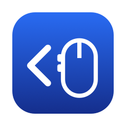

<p align="center"></p>

# 해밀 Back (Haemil Back)

마우스 옆 버튼으로 **뒤로 · 앞으로** 가게 해 주는 맥 메뉴 막대 앱입니다.
게이밍 마우스나 일반 마우스의 옆 버튼은 맥의 Safari · Finder 에서 그냥 무시되는데, 해밀 Back 이 그 신호를 받아 ⌘[ · ⌘] 로 바꿔 보냅니다.
[Bend](https://github.com/HigherOrderCo/Bend) 언어로 썼습니다.

| 버튼 | 동작 |
| --- | --- |
| 아래쪽(뒤쪽) 옆 버튼 | 뒤로 (⌘[) |
| 위쪽(앞쪽) 옆 버튼 | 앞으로 (⌘]) |

Safari, Chrome, Firefox, Finder 등 ⌘[ · ⌘] 를 쓰는 앱에서 동작합니다.

## 설치

1. [최신 HaemilBack.dmg](https://github.com/ShinKwangsub/haemil-back/releases/latest/download/HaemilBack.dmg) 를 받아 엽니다.
2. 해밀 Back 을 응용 프로그램(Applications) 폴더로 끌어 놓고 실행합니다.
3. "손쉬운 사용" 권한을 묻는 창이 뜨면 **시스템 설정 > 개인정보 보호 및 보안 > 손쉬운 사용** 에서 해밀 Back 을 켭니다. 켜면 해밀 Back 이 스스로 다시 시작하며 동작합니다.

맥 13 (Ventura) 이상, 애플 실리콘 · 인텔 모두 지원합니다. 애플 공증을 받은 앱이라 경고 없이 열립니다.
처음 실행하면 로그인 항목에 등록되어 다음부터 자동으로 켜집니다. 끄고 싶으면 **시스템 설정 > 일반 > 로그인 항목** 에서 끕니다.

## 쓰기

메뉴 막대의 마우스 아이콘을 누르면 상태(`작동 중` · `권한 필요`)와 `종료` 가 있습니다.

## 다른 마우스

모델마다 따로 맞출 필요는 없습니다. 해밀 Back 은 맥이 정한 공통 번호인 3번 · 4번 버튼을 봅니다. 옆 버튼이 있는 마우스는 대개 이 번호를 보냅니다.
안 되면 `~/Library/Logs/HaemilBack.log` 를 열어 보세요.

- `버튼 N 은 정한 동작이 없어 그대로 둡니다` 줄이 있으면 그 마우스는 다른 번호를 보냅니다. 이슈로 번호를 알려 주시거나 `back.bend` 의 `Nav.of` 를 고치면 됩니다.
- 아무 줄도 없으면 제조사 프로그램(Logi Options+, Razer Synapse 등)이 옆 버튼을 다른 키로 바꿔 놓은 경우가 많습니다. 그 프로그램에서 옆 버튼을 기본값으로 돌려 주세요.

## 소스에서 빌드

필요한 것: [Bend](https://github.com/HigherOrderCo/Bend) 2.0.39 (`~/.bend/bin/bend`), Xcode 명령줄 도구.

```sh
./build.sh          # "build/Haemil Back.app" (애플 실리콘 + 인텔)
./release.sh        # 서명 · 공증한 dist/HaemilBack-<버전>.dmg (Developer ID 인증서와 notarytool 프로필 필요)
swift tools/icon.swift   # AppIcon.icns 다시 그리기
```

`./build.sh` 는 키체인에 Developer ID 인증서가 없으면 임시 서명합니다. 이 경우 다시 빌드할 때마다 손쉬운 사용 권한을 다시 줘야 합니다.

## 구조

- `back.bend` 는 무엇을 할지 정합니다. 버튼 번호를 `Nav`(뒤로 · 앞으로)로 바꾸는 표와, 입력을 기다려 처리하는 반복이 있습니다.
- `side.c` 는 맥과 만나는 경계입니다. 이벤트 탭으로 3 · 4번 버튼을 가로채 앱에 가지 않게 삼키고, 키를 보내고, 메뉴 막대 아이콘을 띄웁니다. Bend 의 [외부 효과](https://github.com/HigherOrderCo/Bend) 방식(`def ...: import "./side.c"`)으로 붙였습니다.

## 라이선스

MIT ([LICENSE](LICENSE)). 앱 바이너리에는 Apache 2.0 라이선스인 Bend 런타임이 들어 있습니다 ([NOTICE](NOTICE), [licenses/Bend-Apache-2.0.txt](licenses/Bend-Apache-2.0.txt)).

---

## English

Haemil Back is a macOS menu bar app that makes your mouse's side buttons go **Back / Forward** (⌘[ / ⌘]) in Safari, Finder, Chrome and other apps that ignore them. It is written in [Bend](https://github.com/HigherOrderCo/Bend).

- **Install:** download [HaemilBack.dmg](https://github.com/ShinKwangsub/haemil-back/releases/latest/download/HaemilBack.dmg), drag Haemil Back to Applications, open it, and allow it under *System Settings > Privacy & Security > Accessibility*. It restarts itself once allowed and adds itself to Login Items. macOS 13+, Apple silicon and Intel, notarized.
- **Other mice:** Haemil Back listens for the standard macOS mouse buttons 3 and 4, which most side buttons send. If yours does not work, check `~/Library/Logs/HaemilBack.log`, or reset the side buttons in your mouse vendor's software.
- **Build:** `./build.sh` with Bend 2.0.39 and the Xcode command line tools.
- **License:** MIT. The app binary includes the Bend runtime (Apache 2.0), see `NOTICE`.
